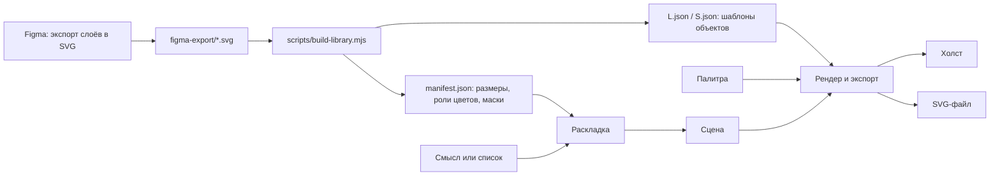

# Сборщик SVG-drop

Веб-сервис, который собирает иллюстрации из готовых векторных объектов библиотеки. Новых объектов он не рисует: в композицию попадают только 10 предметов из Figma (каждый в цветном и фоновом варианте, то есть 20 иллюстраций) в двух размерах детализации, L и S. Геометрия объектов не меняется ни на одну точку, меняются только положение, поворот, порядок слоёв и цвета по ролям палитры.

Сервис: [ppp1qqqq.github.io/svgdropcomposer](https://ppp1qqqq.github.io/svgdropcomposer/). Плагин для Figma лежит в папке `figma-plugin/`, установка описана ниже.


## Что умеет

**Сценарий 1, по смыслу.** Человек пишет заголовок или метафору («Как начать инвестировать со стипендии»), сервис подбирает подходящие объекты и сразу раскладывает их. Подбор работает офлайн по словарю смыслов, а в версии, открытой в Claude, есть кнопка «Подобрать с Claude» для более тонкого разбора метафор. Рядом с результатом видно, почему выбран каждый объект.

**Сценарий 2, по списку.** Человек перечисляет объекты: `книга, 2 монеты, телефон; фон: наушники`. Количество, фоновые объекты и опечатки обрабатываются, незнакомые слова сервис называет и подсказывает, что есть в библиотеке.

**Холст.** Объекты можно перетаскивать, поворачивать за ручку (с Shift шагом 15°), дублировать, удалять и переставлять по слоям: на холсте, в списке слоёв перетаскиванием и с клавиатуры. Есть отмена и повтор. Для каждой сборки предлагаются четыре варианта раскладки и кнопка «Ещё».

**Макеты и форматы.** Три макета, как в примерах SVG-drop из Figma: «Собранно», «Под заголовок» (с подсветкой места под текст) и «Со смещением». Форматы 1200×630, 1920×1080, 1080×1080, 1080×1350 и 1080×1920; при смене формата композиция пересобирается.

**Размеры L и S.** Переключатель меняет детализацию. Объекты нужного размера подгружаются только тогда, когда этот размер выбран, позиции и масштаб при этом сохраняются.

**Палитры.** Три схемы из Figma и свои. Свою палитру можно загрузить файлом (JSON, CSS, текст с HEX-кодами) или вставить кодами. Хватит даже двух цветов: недостающие тона сервис достроит и пометит «авто». Перекраска мгновенная и идёт по ролям, правило библиотеки соблюдается: цвета объектов на фон не ставятся. Сервис предупреждает, если цвет объекта сливается с фоном или контур плохо читается.

**Экспорт.** «Скачать SVG» и «Копировать SVG» (вставляется в Figma через Ctrl+V). Каждый объект в файле лежит отдельной группой с понятным именем слоя, пути остаются векторными. В файл записано описание сцены, поэтому через «Открыть SVG» его можно открыть снова и продолжить правку.

## Запуск

```bash
npm install
npm run dev        # http://localhost:5173
npm test           # 105 проверок ядра
npm run build      # статическая сборка в dist/, её можно выложить на любой хостинг
```

`npm run library` пересобирает библиотеку из `figma-export/`. Это нужно только если в Figma поменялись объекты. Для GitHub Pages в репозитории есть готовый workflow (`.github/workflows/pages.yml`): включите Pages с источником GitHub Actions, и сборка будет публиковаться при каждом push в `main`.

## Плагин для Figma

Тот же сервис собирается плагином: `npm run build:figma` кладёт готовый плагин в папку `figma-plugin/` (там уже лежит собранная версия). Установка в настольном приложении Figma: меню Plugins → Development → Import plugin from manifest, затем выбрать `figma-plugin/manifest.json`. Плагин запускается в любом файле, где есть права на редактирование, и кнопкой «Вставить в Figma» кладёт композицию на холст отдельным фреймом: каждый объект остаётся группой с понятным именем, все пути векторные и редактируются как обычные слои.

Библиотека встроена в плагин, сеть ему нужна только для шрифтов интерфейса. Основной код плагина (`figma-plugin/code.js`) занимает три десятка строк: он открывает интерфейс и превращает присланный SVG в слои через `figma.createNodeFromSvg`.

## Архитектура



### Хранение

Исходники лежат в `figma-export/` ровно в том виде, в каком их отдаёт Figma (экспорт слоёв в SVG с атрибутом id). Скрипт `scripts/build-library.mjs` превращает их в библиотеку `public/library/`:

`manifest.json` описывает для каждого объекта, размера и варианта размер рамки, какие роли палитры он использует и маску занятости (сетка 40×N, где отмечено, какие клетки закрашены). Маски нужны раскладке, чтобы считать пересечения по реальной форме, а не по прямоугольникам.

`L.json` и `S.json` содержат сами объекты. Это тело исходного SVG, в котором HEX-цвета базовой сиреневой палитры заменены токенами ролей (`@@bg1@@`, `@@obj2@@` и т. д.). Пути, их порядок и атрибуты не трогаются. Если в файле встретится цвет вне палитры, сборка остановится с ошибкой: такой объект нельзя было бы перекрасить без потерь.

`svg/L` и `svg/S` хранят те же объекты обычными SVG-файлами с исправленными именами слоёв, чтобы их можно было открыть руками.

### Извлечение

Сервис при старте загружает только `manifest.json`. Шаблоны объектов (`L.json` или `S.json`) подгружаются по требованию, когда выбран соответствующий размер, и кешируются (`src/lib/library.ts`).

Figma пишет кириллицу в id байтами (`&#208;&#154;…`), скрипт сборки это декодирует. Служебные id вида `Vector_12` удаляются, а id, на которые есть ссылки (clipPath у декора фона), получают префикс экземпляра, чтобы копии одного объекта не конфликтовали.

### Переиспользование

Экземпляр объекта на холсте описывается пятью полями: какой объект, вариант (цветной или фон), центр, поворот, место в списке слоёв (`src/types.ts`). При отрисовке шаблон получает цвета палитры подстановкой токенов и вставляется в группу `<g transform="translate rotate scale">` (`src/lib/render.ts`). Холст и экспорт используют одну и ту же функцию, поэтому скачанный файл совпадает с тем, что видно на экране.

Масштаб общий на всю сцену. Относительные размеры объектов сняты с примеров SVG-drop из того же файла Figma: там у книги, телефона, пазла, наушников, лампы и ручки во всех композициях одни и те же пропорции друг к другу. Для монеты, кошелька, папки и цветов коэффициенты подобраны в том же ряду (`src/data/catalog.ts`). S-версии в Figma нарисованы вдвое мельче L, поэтому их масштаб считается от L-размера: при переключении объект остаётся на месте и того же размера.

Тест `npm test` для каждого из 40 файлов библиотеки сравнивает пути в экспортированном SVG с путями в исходнике из Figma и проверяет, что перекраска идёт строго по ролям.

### Подбор по смыслу

`src/lib/semantics.ts`: у каждого объекта есть словарь корней с весами («финанс», «деньг», «стипенд» для монеты, «подкаст», «музык» для наушников). Совпадение ищется по началу слова, так что разные формы одного слова попадают в один корень. Короткие корни, которые ловили бы посторонние слова, записаны точными формами («идея» не ловит «идет», «роза» не ловит «розничный»). Если совпадений мало, набор добирается спутниками выбранных объектов, а если их нет совсем, собирается нейтральная сцена с объяснением.

`src/lib/ai.ts`: в версии, открытой в Claude, тот же запрос можно отдать модели. Ей передаётся каталог объектов с описанием смыслов, ответ проверяется: неизвестные id отбрасываются, так что новых объектов появиться не может.

### Раскладка

`src/lib/layout.ts` генерирует 140 детерминированных по seed кандидатов и оценивает каждый. Кандидат строится в четыре шага. Мелкие плоские объекты с некоторой вероятностью кладутся на подходящие крупные (телефон на книгу, пазл на экран телефона, монета на кошелёк), как в примерах из Figma. Группы выстраиваются в один-три ряда под пропорции области макета, с нахлёстом и ступенькой, мелкий объект может лечь перед соседом. Всё масштабируется одним коэффициентом в область макета. Фоновые объекты ставятся позади так, чтобы главные частично их перекрывали. Оценка учитывает пересечения по маскам, заполнение области, крупность, баланс и выход за край холста. Четыре лучших разных варианта показываются пользователю.

### Палитры

`src/lib/palette.ts`. Палитра состоит из восьми ролей: три цвета фона, три цвета объектов, контур и белый. Загруженная палитра разбирается из JSON (формат экспорта сервиса, роли по именам или массив) или из любого текста с HEX и rgb(). Недостающие роли достраиваются: три тона фона из одного цвета по светлотам, снятым со схем Figma, «Объект 3» как светлый оттенок «Объекта 2». Примеры файлов лежат в `palettes/`.

### Где запускается

Это статическое приложение на React и TypeScript без сервера. Его можно открыть с GitHub Pages или любого хостинга, а также запустить плагином внутри Figma. В версии, опубликованной как артефакт Claude, скачивание идёт через возможность `downloads` (песочница артефакта запрещает обычные загрузки), а подбор по смыслу может использовать Claude через `sample` (`src/lib/platform.ts`).

## Структура

```
figma-export/        исходники из Figma: L/, S/, плашки палитр, примеры SVG-drop
scripts/             сборка библиотеки, запуск тестов
public/library/      готовая библиотека для сервиса
src/data/            каталог объектов, палитры, форматы
src/lib/             ядро: библиотека, смысл, раскладка, палитры, рендер, история
src/components/      холст, панели сборки, слоёв, библиотеки и палитры
figma-plugin/        плагин Figma: manifest.json, code.js и собранный ui.html
tests/               проверки ядра и генерация примеров
examples/            собранные композиции (SVG и PNG-превью)
palettes/            примеры палитр для загрузки
```

## Примеры

| Файл | Как собран |
| --- | --- |
| `examples/01-investments-1200x630.svg` | По смыслу: «Как начать инвестировать со стипендии». L, сиреневая схема, «Собранно» |
| `examples/02-online-course-1080x1080.svg` | По смыслу: «Онлайн-курс для начинающих дизайнеров». L, мятная схема, «Под заголовок» |
| `examples/03-startup-ideas-1200x630-S.svg` | По списку: `лампа, пазл, телефон; фон: книга`. S, персиковая схема, «Со смещением» |

Все три файла можно открыть в сервисе кнопкой «Открыть SVG» и продолжить правку. Пересобрать их: `node scripts/run-ts.mjs tests/make-examples.ts`.

## AI-инструменты

| Инструмент | Для чего |
| --- | --- |
| Claude (Anthropic), агентный режим | Разбор задания и библиотеки в Figma, экспорт SVG, проектирование, код, тесты, примеры композиций |
| Claude через возможность `sample` | Подбор объектов по метафоре внутри сервиса, когда он открыт как артефакт Claude |

Остальное работает без AI: словарь смыслов, раскладка, перекраска и экспорт полностью детерминированы.
